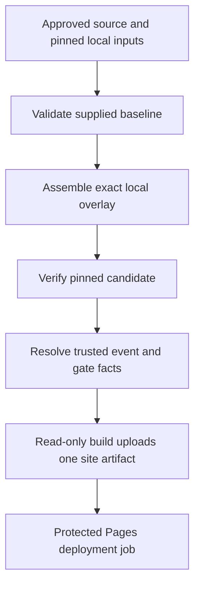

# GitHub Actions integration — review only, unapproved

Phase 2B adds the non-deploying `atlas-release-validation.yml` engineering-branch workflow and `prepare-release.mjs` pinned local-input preflight. See `PHASE2B.md`. The production workflow and live schedule remain unchanged; the historical production-integration proposal below is not activated.

No workflow is installed or changed. The only diff is `cms-guard.REVIEW-ONLY.diff`, against canonical static.yml. It adds one conditional to CMS generation and is explicitly insufficient for safe publication. A complete production workflow diff must wait for an approved baseline-input supply mechanism, source/coverage attestation and publication policy; this document specifies the integration boundary without inventing those inputs.

## Current verified source behaviour

`.github/workflows/static.yml:4–70` at production tree 0f6ac379… triggers main push/manual/schedule every 15 minutes. Products/npm/Operations skip marked static-only or cms-only pushes; CMS runs always. Search verification and whole-tree asset stamping are local. Upload is a single Pages artifact from dist; deploy uses Pages/OIDC. Contents read/pages write/id-token write span the current job. Concurrency pages, cancel-in-progress false. No change to any of this was applied.

Normal fresh build calls: catalogue_components + catalogue_options in product generator, get_site_operations + public_news in Operations generator, public_hub_articles in CMS generator. npm ci and setup-node can contact package/runtime providers; they are not required for these standard-library static tools. None of those generators is invoked by Phase 2A tests/tools.

The proposed CMS condition is:

```yaml
if: github.event_name != 'push' || !contains(github.event.head_commit.message, '[static-only]')
```

It skips CMS only for a static-marked push; manual and schedule still contact Supabase. It neither restores live-only output, validates coverage/protected assets, resolves marker conflict nor prevents global restamping. Applying it alone would leave the production-preservation failure unresolved.

## Proposed controlled static route



Only F/G would require a later production approval. All preceding implementation operates locally/offline; the future provider that supplies approved inputs is not implemented here. No tool auto-downloads a baseline, creates release storage, accesses secrets, triggers GitHub or changes permission settings.

1. Checkout exact approved source without persistent write credentials. Independently compare source commit/tree against owner-approved release identity and then-current main; reject legitimate newer changes until reconciled, never reset/force.
2. A separately reviewed provider supplies a **complete verified public-output baseline** and immutable reviewed input JSON pins. An authentic artifact is preferred; reconstructed capture needs explicit owner coverage/risk approval. Data paths and digest pins are not taken from untrusted PRs/commit text. No ready production baseline exists yet.
3. Run `cli.mjs validate` against the local baseline and independent manifest digest. Confirm independent provenance/production coverage outside this validator; its `not-attested` result is never upgraded merely because valid is true.
4. Run `cli.mjs assemble` with baseline/overlay/protection/policy JSON pins. The actual reviewed Spectre overlay must come from frozen source plus narrowly approved deployment adaptation; synthetic demo inputs must never enter a production release.
5. Run `cli.mjs verify` with the independently retained READY digest. Reject any changed/extra file. Preserve the baseline archive and manifest as a separate durable rollback input **before** upload. The tooling does not authorise backup storage writes.
6. Build the resolver's structured event/ref/message from trusted GitHub runner context, never shell-interpolate a commit message. Set sourceRevisionVerified only after exact identity verification; baselineComplete only after independent accepted production evidence; other gates only from actual validations. Do not load a self-asserted gates=true file from an untrusted branch. If controls are stored in a reviewed JSON artifact, pin its exact bytes in the protected release/environment and bind it to the source SHA and event.
7. Run `cli.mjs resolve --input ... --input-sha256 ...` and parse JSON. Only `allowed:true`, `publicationAllowed:true`, `mode:"static-only"` can enter the new static route. audit-only is not a deploy permission. Contradictory intent, absent evidence or unavailable baseline blocks. No automatic fallback from a failed full build.
8. Static route skips npm ci, product generator, Operations generator, CMS generator, Search verification rewriting and global stamping. It uploads only `candidate/site` once as github-pages; container metadata/recovery archive are excluded. Cache-version only the dedicated overlay's reviewed references.
9. Build job gets contents:read (plus actions:read only if an approved artifact provider genuinely needs it). A distinct deploy job gets pages:write/id-token:write and protected github-pages environment. No contents:write or browser credential/service-role secret. Manual environment approval/branch restrictions must be verified separately; no repository permission was changed.
10. Both legacy and future publication routes must share reviewed concurrency/serialization so a delayed old job cannot erase a newer release. Validate which source and approved baseline is current immediately before upload. Existing Pages pending-run coalescing is not a durable event queue. Do not create another scheduled deployment.

## Exact command wiring contract

The executable command lines and output fields are specified in CONTRACTS.md. Future orchestration must parse JSON rather than evaluate stdout as shell. The assembler returns receiptSHA256, candidateManifestSHA256 and ready; verify returns valid. Passing those locally establishes byte integrity, not owner approval, production completeness or source provenance. Resolver output fields are safe fixed enums/Booleans; exporting them as workflow outputs still requires explicit parsing/validation.

Example future step condition (not installed):

```yaml
if: needs.validate.outputs.mode == 'static-only' && needs.validate.outputs.publication_allowed == 'true' && needs.validate.outputs.candidate_verified == 'true'
```

An untrusted earlier job cannot be allowed to invent those outputs. Input-delivery/attestation and permission boundaries need the exact final YAML diff and synthetic orchestration tests before installation. This is intentionally not represented as an executable production replacement pipeline.

## Event policy and compatibility

| Event | Resolver policy when required gates pass | Future publication treatment |
|---|---|---|
| Main push normal | full-build | Decision only; existing generator path still requires live authoritative data and separate approved publication, not this offline static approval |
| Main static marker | static-only | Verified supplied baseline + allowlisted overlay + pinned verify; no generators |
| Main CMS marker | cms-only | Not backend-independent; no execution under Authorisation 19 |
| Both markers / wrong branch / PR | blocked | No upload/deploy |
| Manual no mode | audit-only | Local checks only; unlike current full-build manual default |
| Manual explicit static mode | static-only | Same gates, no marker/source bypass |
| Schedule | audit-only | Proposed resolver never grants scheduled publication. Existing live schedule remains unchanged. Integrating this policy into existing scheduled publishing needs explicit owner approval; do not silently change cadence |
| Backend outage | No automatic authority change | Explicit static route has no dependency; full/CMS failure cannot fall back to stale fixture data |
| Build/integrity/cancel failure | Block | Never upload partial site/staging; preserve previous deployment |
| Deployment failure | Inspect run/attempt/artifact | No automatic rollback or repeated contaminated-attempt rerun. Later approved retry must produce exactly one fresh artifact |

## Rollback and retention

Retain pre-overlay full baseline and post-overlay candidate with independent digests in separately approved durable storage; Actions one-day artifact retention is insufficient as the only recovery method. Do not assume Pages retains files omitted from a new artifact. RC07's image archive/initialisation policy remains separate and unchanged. Never introduce static delivery before assets and manifests are verified and durably recoverable.

A production rollback requires separate authority and reconciliation with intervening releases. This assembler implements **no deletion**, including deleting V02. Revalidate the original baseline and restore its verified artifact only if no later legitimate changes would be lost; otherwise design an explicitly reviewed reverse overlay in a future approval. No database rollback, image deletion or force-push.
