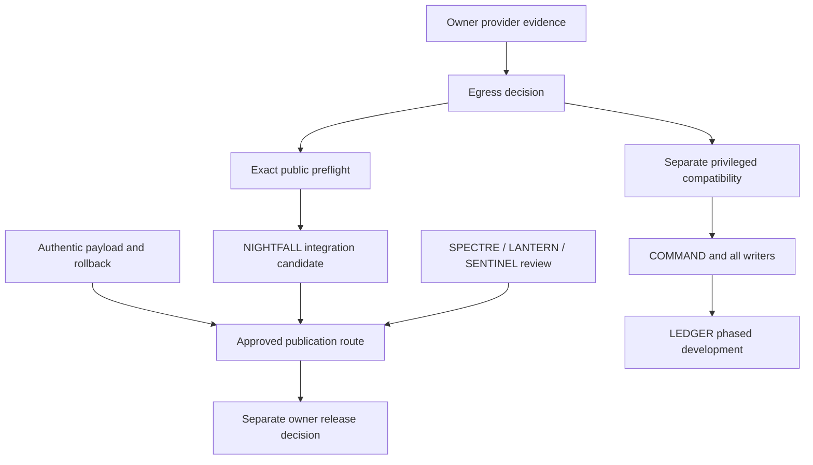

# Cross-branch integration architecture

| ID / relationship | Exact overlapping paths / contracts | Evidence finding | Required gate |
|---|---|---|---|
| I01 COMPATIBLE BY SOURCE INSPECTION (SPECTRE, RELEASE) | dist/customer-ui.css | Same reviewed CSS blob on both heads; these are alternative packaging of one correction, not two fixes. | Choose exact CSS-only overlay; complete payload/rollback and owner approval |
| I02 POTENTIAL CONFLICT (NIGHTFALL, SENTINEL) | No overlapping changed paths; semantic integration only | No overlapping changed paths against main, but shared product renderer/catalogue/generator/image lifecycle contracts are semantic dependencies. | Compose only in a separately authorised candidate; test generated shell, images, failure recovery, stock and basket lifecycle |
| I03 PREREQUISITE (LIGHTHOUSE, SENTINEL) | dist/basket-ui.mjs | SENTINEL descends from tested LIGHTHOUSE 932f714, not documentation head 3503240. Do not use a giant merge to import duplicated reports/harnesses. | Use tested source ancestry and retain independent evidence identities |
| I04 POTENTIAL CONFLICT (C04, CAT, CHECKOUT, EXT, LEDGER) | dist/backend/component-data.mjs, supabase/migrations/20260930114021_external_orders_v1.sql | IRONCLAD assumes all participating product/stock/cost writers share revision/transaction authority; legacy direct REST and paid-order writers do not establish that contract. | Bounded deployed compatibility, all-writer reconciliation and synthetic transaction tests before adoption |
| I05 POTENTIAL CONFLICT (NOCTURNE, ADMIN) | No overlapping changed paths; semantic integration only | No shared changed paths; separate prototype and existing Admin shells/controller lifecycles overlap in purpose. | Define route/shell ownership and preserve specialist features; no wholesale replacement |
| I06 REQUIRES LIVE COMPATIBILITY CHECK (AUTHOR, WEB, HUB) | dist/admin/conjure/page-mappings.mjs | Private source fingerprints, published CMS generation and public page output are separate authorities. | Do not add a public universal-document renderer without an approved version/publication contract |
| I07 SUPERSEDED (IMAGEPREP, NIGHTFALL) | dist/backend/catalogue-image-delivery.mjs, scripts/generate-product-pages.mjs | NIGHTFALL evolves the prepared adapter; avoid layering both legacy image fallback and the newer verified-demand contract. | Select one explicit contract and approve deployed view/reference semantics |
| I08 COMPATIBLE BY SOURCE INSPECTION (STUDIO, INSTRUMENT) | supabase/migrations/20261008152227_email_template_studio_giga_v1.sql, supabase/migrations/20261009110115_forge_instrument_workspace_v3.sql | Both source hashes match historical approved hashes; deployment ledger timestamps differ from filenames by recorded Management API assignment. | Verify installed checksums/objects before any migration; do not treat timestamp difference alone as new unapplied SQL |
| I09 DEMONSTRATED CONFLICT (CHECKOUT) | supabase/migrations/20260925104500_p07b_qualify_delivery_country.sql, supabase/migrations/20260925151500_p07b2a_qualify_inventory_update.sql | Two exact filenames contain different Git blobs on older recovery heads versus current main. This is demonstrated source-byte divergence, not proof of live DB failure. | Preserve variants; establish actual deployed version/checksum and ordered function definition history |
| I10 PREREQUISITE (WIRE, CIRCUIT, RESPONSE, KIT) | dist/electronics/instrument/capabilities.mjs | Physical wiring, numerical response and commercial BOM eligibility must remain independently gated. | No duplicated electrical truth table or unsupported handoff |
| I11 PREREQUISITE (MAIL, PREVIEW, AFTERCARE, STUDIO, EXT) | supabase/functions/transactional-email/index.ts | Frontend, SQL claims/versions and Edge renderer/signing identity must be deployed compatibly; immutable snapshots and explicit confirmation remain authority. | Review exact installed function/version/grants without sending mail; stale previews regenerated |
| I12 PREREQUISITE (CACHE, RELEASE, NIGHTFALL) | .github/workflows/static.yml | Daily job remains backend-dependent, including unconditional CMS RPC. Static-only marker does not make the complete job backend-free. | Explicit egress decision; later approved publication-only route; no workflow edits in this audit |

## Dependency graph

The graph expresses prerequisites, not execution permission or a one-day plan. Offline policy/source/isolated composition may proceed under separate engineering scope while provider evidence is pending. Customer-facing CSS/JS corrections do not inherently require NIGHTFALL activation or a major DB migration, but still require an accepted egress exposure decision, complete payload/rollback and release acceptance. Privileged COMMAND compatibility is not granted by public preflight success.

No merge or trial giant integration was performed. Exact main-relative changed-path sets were compared. Pairwise no-overlap is not semantic proof; category/product generation, module bootstrap, image lifetime, shell/controller mounting, private auth and post-write cache invalidation must be tested together in a newly authorised candidate. Frozen workflows, tests and reports must not be imported wholesale merely to obtain a fix. Preserve original tested and final documentation identities independently.

Recommended code composition: adopt one exact reviewed SPECTRE CSS overlay; one LANTERN/LIGHTHOUSE source line plus SENTINEL descendants; one evolved NIGHTFALL image contract; the cumulative COMMAND→NOCTURNE chain with specialist Admin adapters and a reviewed real server boundary. Do not merge all historical BLACKBOX/Atlas phases or reapply old recovery branches already included in main. Existing email/Forge/CMS capabilities need deployed compatibility/acceptance before enhancement, not reimplementation as new projects.
